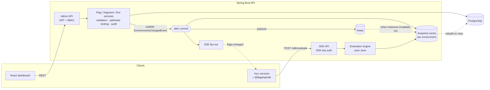

# Flagship — Feature Flag Platform

A self-hosted feature flag and experimentation platform: decouple **deploy** from **release**, roll out
gradually, target precisely, and kill a misbehaving feature in seconds — without redeploying.

Full stack: **Spring Boot 4 / Java 21** API, **React 19 + TypeScript** dashboard, and a zero-dependency
**TypeScript SDK** that receives changes in real time over Server-Sent Events.


## Highlights

| Area | What's there |
|---|---|
| **Evaluation engine** | Pure, side-effect-free Java engine: individual targets → rules (AND of clauses, first match wins) → default rule; 15 operators incl. regex, SemVer and date comparisons, negation, reusable **segments**, flag **prerequisites** with cycle detection, and an explained **reason** for every result. |
| **Percentage rollouts** | Deterministic MurmurHash3 bucketing with per-flag salt, 0.001% granularity, custom bucketing attribute (e.g. roll out per `orgId`). Sticky, monotonic on ramp-up, uncorrelated across flags — all three properties are unit-tested statistically. |
| **Local evaluation** | Server-side SDK downloads the ruleset (ETag/304) and evaluates in-process in **~2 µs per flag**, with no network call per check. A port of the Java engine, held to **176 shared cross-language conformance vectors** that both builds run, and verified live: **70,000 evaluations, 0 mismatches** against the server. |
| **Real-time delivery** | Immutable per-environment snapshots cached in memory (no DB on the hot path), invalidated after commit; SSE stream tells SDKs to refresh within milliseconds. |
| **Horizontal scaling** | Run any number of API instances: invalidations (and SDK key revocations) fan out over **Redis pub/sub**, with a max snapshot age bounding staleness if a message is ever lost. Degrades gracefully — instances boot and serve with Redis down, and resubscribe when it returns. Covered by a test that runs two full instances side by side. |
| **Safety** | Optimistic locking on targeting (409 instead of lost updates), server-side validation with path-addressed errors, archive-before-delete, dependency checks, production toggle confirmation, every change audited **in the same transaction** with before/after state. |
| **Security** | JWT for people with an `ADMIN ⊃ EDITOR ⊃ VIEWER` role hierarchy enforced by method security; per-environment SDK keys stored only as SHA-256 hashes, rotatable; RFC 9457 problem responses. |
| **Performance** | Load-tested with Gatling: **4,000 req/s with zero errors** on a shared 4-vCPU box (p99 7 ms at 1,000 req/s); evaluating all flags for a user takes **25 µs** (median) in-process; a cache rebuild every 2 s under load moves p99 by only ~2 ms. Methodology and caveats in [docs/PERFORMANCE.md](docs/PERFORMANCE.md). |
| **Ops** | Flyway migrations portable across PostgreSQL & H2, Micrometer metrics (Prometheus), health probes, structured JSON logs in `prod`, layered Docker images, CI on both databases. |
| **Dashboard** | Flag list with per-environment kill switches, full targeting editor (rules, segments, rollouts, prerequisites), environment promotion, evaluation debugger, audit log with JSON diffs, stale-flag detection. |

## Architecture



Write path: a change is validated, persisted and audited in one transaction. After commit, the affected
environments' snapshots are dropped and connected SDKs are told to refresh — first on the instance that made
the change, then on every other instance via a Redis pub/sub message (`ffp.cluster.mode=redis`). Read path: evaluation runs
against an immutable in-memory snapshot, so it never touches the database and never sees a half-applied change.

See **[docs/DESIGN.md](docs/DESIGN.md)** for the reasoning behind these choices, trade-offs, and how this would scale out.

## Quick start

### Docker (everything)

```bash
docker compose up --build
```

- Dashboard → http://localhost:3000 (`admin@ffp.local` / `admin123`, also `editor@…/editor123`, `viewer@…/viewer123`)
- API docs → http://localhost:8080/swagger-ui.html
- The stack runs **two API replicas** (`:8080`, `:8081`) behind nginx, kept in sync over Redis. Toggle a flag
  through one and evaluate through the other:

  ```bash
  curl -s localhost:8081/api/v1/sdk/evaluate/payments-enabled -H 'X-SDK-Key: sdk-demo-production-00000000000000000000000' \
    -H 'Content-Type: application/json' -d '{"key":"u"}'
  ```

### Local development

Requirements: Java 21, Maven, Node 22.

```bash
# API on :8080 with in-memory H2 and demo data
cd backend && mvn spring-boot:run

# Dashboard on :5173 (proxies /api to :8080)
cd frontend && npm install && npm run dev

# Watch flags change live from a Node process
cd sdk/js && npm install && npm run build && node examples/node-demo.mjs
```

To run the API against PostgreSQL: `FFP_DB_URL=jdbc:postgresql://localhost:5432/ffp FFP_DB_USER=… FFP_DB_PASSWORD=… mvn spring-boot:run`.
For multi-instance mode add `FFP_CLUSTER_MODE=redis` (plus `FFP_REDIS_HOST`/`FFP_REDIS_PORT`); single-instance mode
(the default) needs no Redis.

The demo project (`demo-app`) is seeded with a progressive release (`new-checkout`), a dependent feature
(`checkout-upsell`), an A/B/n experiment (`search-algorithm`), per-plan limits (`max-upload-size-mb`),
a version-gated mobile feature (`mobile-dark-mode`), remote JSON config (`pricing-config`) and a kill switch
(`payments-enabled`). Demo SDK keys (development only) are in `backend/src/main/resources/application.yml`.

## Using the SDK

Two clients, one package:

```ts
import { FlagClient, LocalFlagClient } from '@flagship/sdk';

// Backend services: download the rules once, evaluate any user in-process (~2 µs, no network).
const flags = new LocalFlagClient({ baseUrl: 'https://flags.example.com', sdkKey: process.env.FLAG_SDK_KEY! });
await flags.start();
app.get('/checkout', (req, res) => {
  const user = { key: req.user.id, attributes: { email: req.user.email, plan: req.user.plan } };
  flags.boolVariation('new-checkout', user, false) ? renderNew(res) : renderOld(res);   // never throws
});

// User-facing apps: the server evaluates for the one current user; results are cached.
const client = new FlagClient({ baseUrl, sdkKey });
await client.identify({ key: user.id, attributes: { appVersion: '2.4.0' } });
client.boolVariation('mobile-dark-mode', false);
client.on('change', ({ changed }) => rerender(changed));       // pushed over SSE in milliseconds
```

Both keep serving last-known values if the platform is unreachable, coalesce bursts of change
notifications, reconnect with exponential backoff + full jitter, and explain every result
(`variationDetail(...).reason`). `node sdk/js/examples/differential-check.mjs` compares local and server
evaluation for 10,000 random users against a running instance.

Or call the API directly:

```bash
curl -s localhost:8080/api/v1/sdk/evaluate/new-checkout \
  -H 'Authorization: sdk-demo-production-00000000000000000000000' -H 'Content-Type: application/json' \
  -d '{"key":"user-1","attributes":{"email":"jane@acme.com"}}'
# {"value":true,"variation":0,"reason":{"kind":"RULE_MATCH","ruleIndex":0,"ruleId":"…"},"version":1}
```

## API overview

| | Endpoint | Role |
|---|---|---|
| Auth | `POST /api/v1/auth/login`, `GET /api/v1/auth/me` | — |
| Projects | `GET/POST /api/v1/projects`, `GET/PUT/DELETE /api/v1/projects/{p}` | viewer / admin |
| Environments | `GET/POST …/{p}/environments`, `PUT/DELETE …/{e}`, `POST …/{e}/sdk-key/rotate` | viewer / admin |
| Flags | `GET/POST …/{p}/flags` (search, tag filter, paging), `GET/PATCH/DELETE …/flags/{f}`, `POST …/{f}/archive\|restore` | viewer / editor |
| Targeting | `GET/PUT …/flags/{f}/environments/{e}` (versioned), `POST …/toggle`, `POST …/copy` | viewer / editor |
| Segments | `GET/POST …/{p}/segments`, `GET/PUT/DELETE …/segments/{s}` | viewer / editor |
| Debugger | `POST …/{p}/environments/{e}/evaluate` | viewer |
| Audit | `GET …/{p}/audit?resourceKey=&environment=&page=` | viewer |
| Users | `GET/POST /api/v1/users`, `PUT /api/v1/users/{id}/role` | admin |
| **SDK** | `POST /api/v1/sdk/evaluate`, `POST /api/v1/sdk/evaluate/{flag}`, `GET /api/v1/sdk/stream` (SSE) | SDK key |

All errors are `application/problem+json`; validation failures (422) include an `errors` array such as
`"rules[1].clauses[0]: 'abc' is not a number"`. Interactive docs: `/swagger-ui.html`.

## Testing

```bash
cd backend && mvn verify          # 112 unit + integration tests (H2 by default; set FFP_DB_URL to run on PostgreSQL)
cd frontend && npm test           # component + logic tests (Vitest, Testing Library)
cd sdk/js && npm test             # 192 tests: conformance vectors, both clients, SSE parsing, backoff
cd loadtest && mvn gatling:test -Dsimulation=ffp.loadtest.SdkEvaluationSimulation -Drps=1000   # against a running API
```

**Cross-language conformance.** `conformance/evaluation-vectors.json` holds 176 cases (MurmurHash3 reference
values, bucket assignments, all 15 operators with their edge cases, full evaluations with exact reasons). The Java
engine and the TypeScript SDK both run every case, so the two implementations cannot drift apart silently.

Backend tests cover the engine exhaustively (MurmurHash3 reference vectors, rollout distribution/stickiness/
independence, every operator, evaluation precedence, prerequisite cycles, a deterministic race test for the
snapshot cache) and exercise the full HTTP + security + persistence stack end-to-end (RBAC, optimistic-lock
conflicts, cache invalidation visible through the SDK API, key rotation, segment and prerequisite integrity).
A multi-instance test boots two complete instances against one database and Redis, changes a flag through one
and asserts the other's cache, SSE clients and SDK-key cache all follow (it needs Redis on `localhost:6379`;
skipped locally without it, mandatory in CI). CI runs the backend suite against both H2 and PostgreSQL 16.

## Project layout

```
backend/   Spring Boot API
  evaluation/model    immutable domain records (Targeting, Rule, Clause, Rollout, …)
  evaluation/engine   pure evaluator, bucketing, clause matching, validation — no Spring
  evaluation/runtime  snapshot cache, evaluation service + metrics, SSE fan-out
  cluster/            change propagation: apply locally after commit, broadcast via Redis pub/sub
  flag/ segment/ environment/ project/ auth/ audit/ sdk/   feature slices (entity, repo, service, controller)
  resources/db/migration   Flyway migrations
frontend/  React dashboard (TanStack Query, React Router)
sdk/js/    TypeScript SDK (remote + local evaluation clients, engine port)
conformance/  evaluation vectors shared by the Java engine and the TypeScript SDK
loadtest/  Gatling load tests (steady-state SDK traffic; SDK traffic while flags change)
docs/      design notes and screenshots
```
