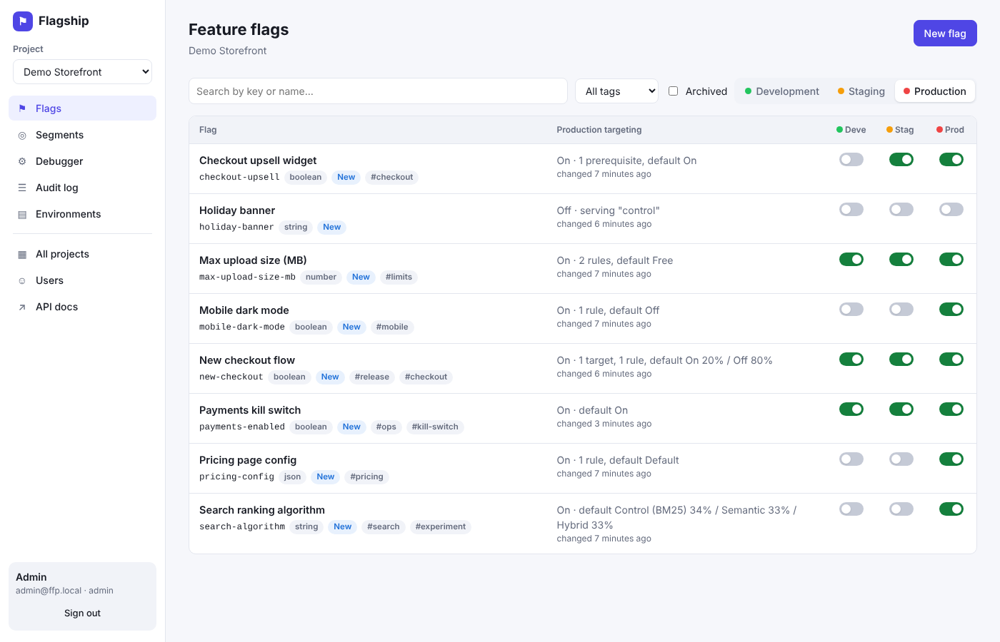
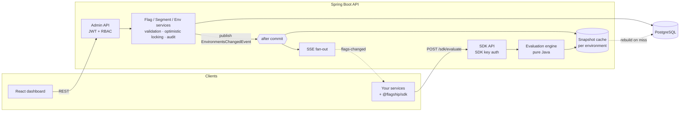

# Flagship — Feature Flag Platform

A self-hosted feature flag and experimentation platform: decouple **deploy** from **release**, roll out
gradually, target precisely, and kill a misbehaving feature in seconds — without redeploying.

Full stack: **Spring Boot 4 / Java 21** API, **React 19 + TypeScript** dashboard, and a zero-dependency
**TypeScript SDK** that receives changes in real time over Server-Sent Events.



## Highlights

| Area | What's there |
|---|---|
| **Evaluation engine** | Pure, side-effect-free Java engine: individual targets → rules (AND of clauses, first match wins) → default rule; 15 operators incl. regex, SemVer and date comparisons, negation, reusable **segments**, flag **prerequisites** with cycle detection, and an explained **reason** for every result. |
| **Percentage rollouts** | Deterministic MurmurHash3 bucketing with per-flag salt, 0.001% granularity, custom bucketing attribute (e.g. roll out per `orgId`). Sticky, monotonic on ramp-up, uncorrelated across flags — all three properties are unit-tested statistically. |
| **Real-time delivery** | Immutable per-environment snapshots cached in memory (no DB on the hot path), invalidated after commit; SSE stream tells SDKs to refresh within milliseconds. |
| **Safety** | Optimistic locking on targeting (409 instead of lost updates), server-side validation with path-addressed errors, archive-before-delete, dependency checks, production toggle confirmation, every change audited **in the same transaction** with before/after state. |
| **Security** | JWT for people with an `ADMIN ⊃ EDITOR ⊃ VIEWER` role hierarchy enforced by method security; per-environment SDK keys stored only as SHA-256 hashes, rotatable; RFC 9457 problem responses. |
| **Ops** | Flyway migrations portable across PostgreSQL & H2, Micrometer metrics (Prometheus), health probes, structured JSON logs in `prod`, layered Docker images, CI on both databases. |
| **Dashboard** | Flag list with per-environment kill switches, full targeting editor (rules, segments, rollouts, prerequisites), environment promotion, evaluation debugger, audit log with JSON diffs, stale-flag detection. |

## Architecture



Write path: a change is validated, persisted and audited in one transaction. After commit, the affected
environments' snapshots are dropped and connected SDKs are told to refresh. Read path: evaluation runs
against an immutable in-memory snapshot, so it never touches the database and never sees a half-applied change.

See **[docs/DESIGN.md](docs/DESIGN.md)** for the reasoning behind these choices, trade-offs, and how this would scale out.

## Quick start

### Docker (everything)

```bash
docker compose up --build
```

- Dashboard → http://localhost:3000 (`admin@ffp.local` / `admin123`, also `editor@…/editor123`, `viewer@…/viewer123`)
- API docs → http://localhost:8080/swagger-ui.html

### Local development

Requirements: Java 21, Maven, Node 22.

```bash
# API on :8080 with in-memory H2 and demo data
cd backend && mvn spring-boot:run

# Dashboard on :5173 (proxies /api to :8080)
cd frontend && npm install && npm run dev

# Watch flags change live from a Node process
cd sdk/js && npm install && npm run build && node examples/node-demo.mjs
```

To run the API against PostgreSQL: `FFP_DB_URL=jdbc:postgresql://localhost:5432/ffp FFP_DB_USER=… FFP_DB_PASSWORD=… mvn spring-boot:run`.

The demo project (`demo-app`) is seeded with a progressive release (`new-checkout`), a dependent feature
(`checkout-upsell`), an A/B/n experiment (`search-algorithm`), per-plan limits (`max-upload-size-mb`),
a version-gated mobile feature (`mobile-dark-mode`), remote JSON config (`pricing-config`) and a kill switch
(`payments-enabled`). Demo SDK keys (development only) are in `backend/src/main/resources/application.yml`.

## Using the SDK

```ts
import { FlagClient } from '@flagship/sdk';

const flags = new FlagClient({ baseUrl: 'https://flags.example.com', sdkKey: process.env.FLAG_SDK_KEY! });
await flags.identify({ key: user.id, attributes: { email: user.email, plan: user.plan, appVersion: '2.4.0' } });

if (flags.boolVariation('new-checkout', false)) renderNewCheckout();          // never throws; falls back to default
const { value, reason } = flags.variationDetail('search-algorithm', 'bm25'); // log `reason` with experiment events
flags.on('change', ({ changed }) => console.log('updated:', changed));       // pushed over SSE
```

The SDK keeps serving last-known values if the platform is unreachable, coalesces bursts of change
notifications into at most one follow-up request, and reconnects with exponential backoff + full jitter.

Or call the API directly:

```bash
curl -s localhost:8080/api/v1/sdk/evaluate/new-checkout \
  -H 'Authorization: sdk-demo-production-00000000000000000000000' -H 'Content-Type: application/json' \
  -d '{"key":"user-1","attributes":{"email":"jane@acme.com"}}'
# {"value":true,"variation":0,"reason":{"kind":"RULE_MATCH","ruleIndex":0,"ruleId":"…"},"version":1}
```

## API overview

| | Endpoint | Role |
|---|---|---|
| Auth | `POST /api/v1/auth/login`, `GET /api/v1/auth/me` | — |
| Projects | `GET/POST /api/v1/projects`, `GET/PUT/DELETE /api/v1/projects/{p}` | viewer / admin |
| Environments | `GET/POST …/{p}/environments`, `PUT/DELETE …/{e}`, `POST …/{e}/sdk-key/rotate` | viewer / admin |
| Flags | `GET/POST …/{p}/flags` (search, tag filter, paging), `GET/PATCH/DELETE …/flags/{f}`, `POST …/{f}/archive\|restore` | viewer / editor |
| Targeting | `GET/PUT …/flags/{f}/environments/{e}` (versioned), `POST …/toggle`, `POST …/copy` | viewer / editor |
| Segments | `GET/POST …/{p}/segments`, `GET/PUT/DELETE …/segments/{s}` | viewer / editor |
| Debugger | `POST …/{p}/environments/{e}/evaluate` | viewer |
| Audit | `GET …/{p}/audit?resourceKey=&environment=&page=` | viewer |
| Users | `GET/POST /api/v1/users`, `PUT /api/v1/users/{id}/role` | admin |
| **SDK** | `POST /api/v1/sdk/evaluate`, `POST /api/v1/sdk/evaluate/{flag}`, `GET /api/v1/sdk/stream` (SSE) | SDK key |

All errors are `application/problem+json`; validation failures (422) include an `errors` array such as
`"rules[1].clauses[0]: 'abc' is not a number"`. Interactive docs: `/swagger-ui.html`.

## Testing

```bash
cd backend && mvn verify          # 102 unit + integration tests (H2 by default; set FFP_DB_URL to run on PostgreSQL)
cd frontend && npm test           # component + logic tests (Vitest, Testing Library)
cd sdk/js && npm test             # SSE parsing, fallbacks, change detection, reconnect backoff
```

Backend tests cover the engine exhaustively (MurmurHash3 reference vectors, rollout distribution/stickiness/
independence, every operator, evaluation precedence, prerequisite cycles, a deterministic race test for the
snapshot cache) and exercise the full HTTP + security + persistence stack end-to-end (RBAC, optimistic-lock
conflicts, cache invalidation visible through the SDK API, key rotation, segment and prerequisite integrity).
CI runs the backend suite against both H2 and PostgreSQL 16.

## Project layout

```
backend/   Spring Boot API
  evaluation/model    immutable domain records (Targeting, Rule, Clause, Rollout, …)
  evaluation/engine   pure evaluator, bucketing, clause matching, validation — no Spring
  evaluation/runtime  snapshot cache, evaluation service + metrics, SSE fan-out
  flag/ segment/ environment/ project/ auth/ audit/ sdk/   feature slices (entity, repo, service, controller)
  resources/db/migration   Flyway migrations
frontend/  React dashboard (TanStack Query, React Router)
sdk/js/    TypeScript SDK
docs/      design notes and screenshots
```
